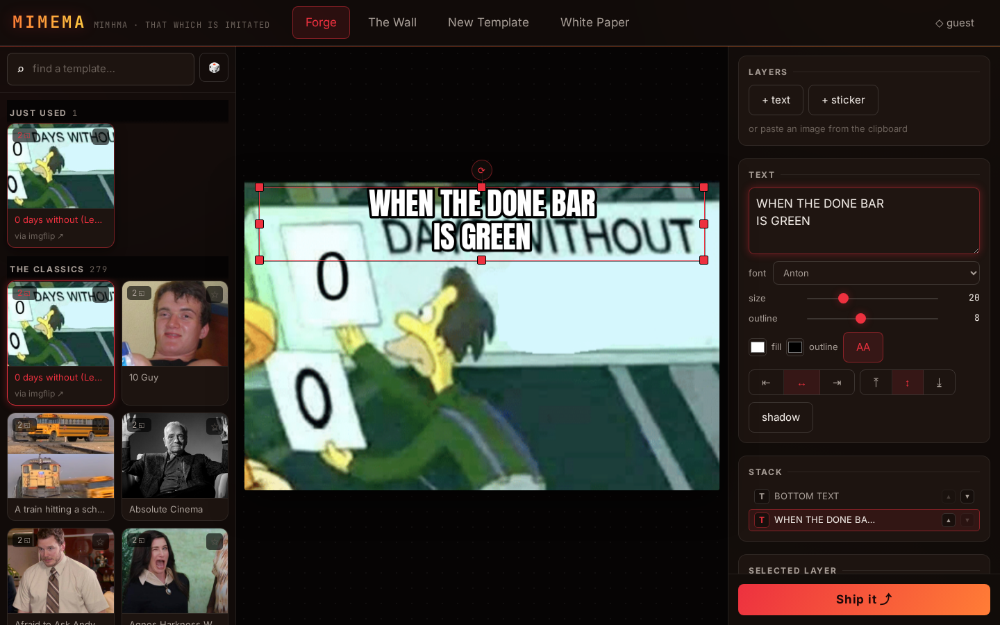
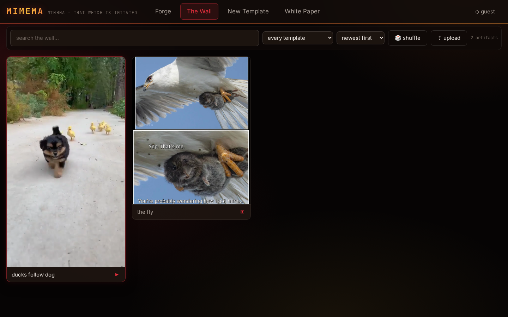
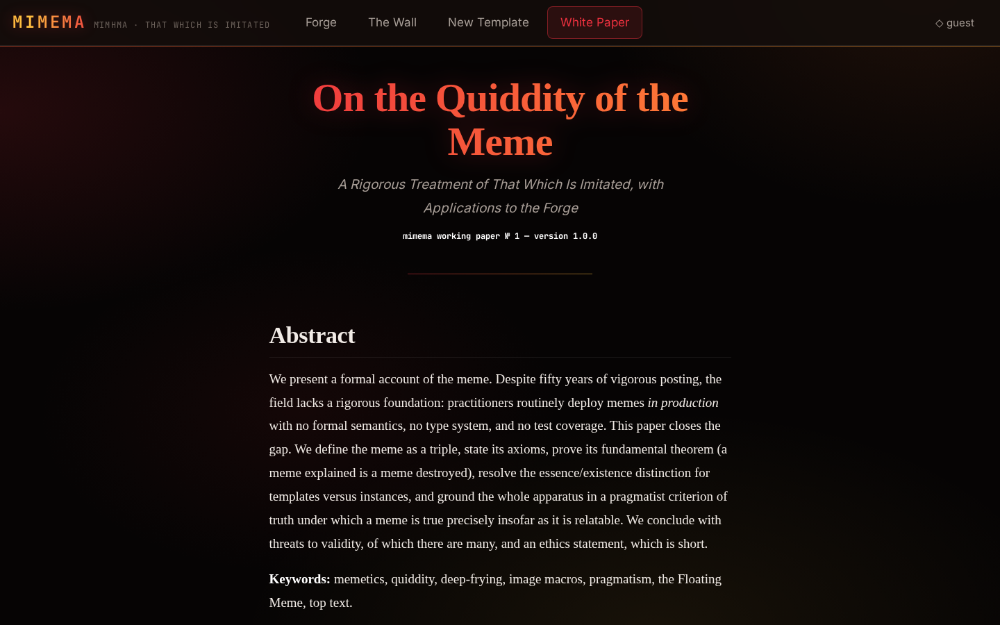

# mimema

[](https://github.com/ZahakJ/mimema/actions/workflows/ci.yml)
[](LICENSE)

**μίμημα** — *that which is imitated*. A meme forge and self-hosted media host,
dark and epic, running at [meme.avicenna.space](https://meme.avicenna.space).

Dawkins cut "meme" out of the Greek *mimeme* so it would sound like "gene." This
is the uncut version: forge a meme in the browser, download the PNG, or publish
it to a permanent, hotlinkable URL that unfurls properly in every chat app.




## Features

- **The Forge** — ~290 classic templates (or any image you upload), draggable
  text zones, meme-grade faces (Anton, Bangers, Oswald) with proper outlines and
  drop shadows, per-zone font/size/color/rotation, stickers pasted straight from
  the clipboard, a layer stack, undo/redo, drafts that survive a refresh,
  copy-PNG-to-clipboard, and a deep-fry toggle with live preview.
- **The Wall** — publish with the invite key and every artifact gets a fun
  permanent slug (`unhinged-capybara`), a direct hotlink, an OpenGraph share page
  that unfurls in Discord/Telegram/Slack, tags, 🔥 💀 🗿 reactions, and a spot on
  the masonry wall with search, tag/template filters, sorting, shuffle, and a
  lightbox with inline editing for key-holders.
- **The Zone Editor** — upload any screenshot, draw its text zones (live
  placeholder preview, eight resize handles), name it, and it joins the template
  pack for everyone. The picker keeps favorites and your recently used.
- **White Paper** — the in-app whitepaper, *On the Quiddity of the Meme*
  ([WHITEPAPER.md](WHITEPAPER.md)), rendered at `#/paper`.
- **Media host** — PNG, JPEG, GIF, WebP, MP4, and WebM served with byte-range
  support and one-year immutable caching. Identical bytes dedup to one slug.
- **One render path** — what you see in the preview is exactly what exports,
  because they are literally the same function.
- **Small and boring underneath** — no ORM, no image-processing native modules,
  no bundler for the server. `node:sqlite` for metadata, plain files for blobs.

## Quickstart

Requires **Node 26+** (the server runs TypeScript directly via type-stripping).

```sh
git clone <your-fork> mimema && cd mimema
npm install
npm run templates      # fetch the classic template pack into data/
npm run seed           # optional: import seed-assets/ as the first wall items
cp .env.example .env   # set INVITE_KEY
npm start              # http://127.0.0.1:8001
```

`npm start` serves the API and, if you've run `npm run build`, the client bundle
from `dist/`. Without a build it will tell you so and stay up for API work.

> **On the template pack.** `npm run templates` fetches the classic packs from
> imgflip and memegen.link (~290 templates, attribution recorded and linked in
> the UI) at install time into the gitignored `data/` directory. Those images are
> **not redistributed in this repository** and remain the property of their
> respective owners. The script is idempotent — re-run it any time;
> already-present templates are skipped.

## Configuration

All configuration is environment variables, read from `.env` (see
`.env.example`). Nothing is required except a key if you want writes.

| Variable | Default | What it does |
| --- | --- | --- |
| `INVITE_KEY` | *(empty)* | Shared passphrase for publishing, uploading, adding templates, and deleting. **Empty means all writes are disabled** and the server says so on boot. |
| `HOST` | `127.0.0.1` | Bind address. At the default it also binds `::1`, because tunnels resolving `localhost` to IPv6 will otherwise 502. |
| `PORT` | `8001` | Listen port. |
| `PUBLIC_ORIGIN` | `http://localhost:<PORT>` | Origin used to build absolute URLs in OpenGraph tags. Set this to your public origin or share links will point at localhost. |
| `DATA_DIR` | `./data` | Where the SQLite database, media blobs, and template images live. |
| `ALLOW_VIDEO` | `1` | Set to `0` to refuse MP4/WebM uploads. |
| `RATE_LIMIT` | `1` | Set to `0` to disable the built-in per-IP rate limiting. |
| `RATE_LIMIT_VERIFY` / `_WRITE` / `_READ` / `_REACT` / `_WINDOW_MS` | `10` / `30` / `120` / `60` / `60000` | Requests allowed per window for key verification, writes, reads, and reactions. |

Upload caps are 12 MB for images and 40 MB for video. Use a long `INVITE_KEY`
(`openssl rand -base64 24`) — the server warns on boot below 12 characters.

## Development

Two terminals:

```sh
npm run dev:server     # Hono API on :5900
npm run dev            # Vite on :5901, proxying /api, /m, /t → :5900
```

The done bar, which every change must clear:

```sh
npm run typecheck && npm test && npm run build && npm run smoke
```

`smoke` drives a real browser with Playwright against a preview build, fails on
any console error, and drops fresh screenshots in `screenshots/`.

See [CONTRIBUTING.md](CONTRIBUTING.md) before opening a PR.

## Architecture

Single npm package, three source roots, no monorepo tooling.

```
client/    Vite 7 + React 19 — editor/ (the forge), gallery/ (the wall),
           zone-editor/ (make templates), hash routes in router.ts
server/    Hono 4 on Node, run directly from TypeScript (no build step).
           app.ts is listen-free so tests drive app.request() in-process.
shared/    schema.ts — zod schemas for zones, layers, and wire DTOs.
```

Load-bearing decisions:

- **`renderMeme` is the only render path.** The canvas preview and the PNG
  export call the same function; export simply re-renders at the template's
  native resolution. They cannot diverge because there is nothing to diverge
  from.
- **One fractional coordinate system.** Zones and layers are `x/y/w/h ∈ 0..1` of
  the document, shared by template presets, editor math, and the zone editor. A
  meme is scale-free; so is its geometry.
- **Sniffed MIME is truth.** `server/sniff.ts` decides type and extension from
  magic bytes. Client-declared content types are ignored entirely. SVG is
  deliberately unsupported — scriptable XML on a hotlinkable origin is an XSS
  vector, not a feature.
- **Media URLs are immutable.** `/m/<slug>.<ext>` is served with a one-year
  immutable cache; a new upload gets a new slug, never a new body at an old URL.
  `/m/<slug>` (no extension) is the share page carrying the OpenGraph tags.
- **Items dedup by sha256.** Re-uploading identical bytes returns the existing
  slug instead of a second copy.
- **Auth is one shared key**, sent as `x-meme-key` and compared as a
  constant-time hash. Reads are public; every write is gated.

## Deployment

The server is a single long-lived Node process behind whatever you already use
for TLS — nginx, Caddy, Traefik, a Cloudflare tunnel, a Tailscale node. It binds
loopback by default and expects something in front of it.

A systemd **user** unit is included at [`deploy/meme.service`](deploy/meme.service);
symlink it into `~/.config/systemd/user/` and enable it:

```sh
ln -s "$PWD/deploy/meme.service" ~/.config/systemd/user/meme.service
systemctl --user daemon-reload
systemctl --user enable --now meme.service
curl http://127.0.0.1:8001/healthz     # → ok
```

After changing client code: `npm run build && systemctl --user restart meme.service`.

The reference deployment puts a Cloudflare tunnel in front of port 8001, but
nothing in the code knows or cares — any reverse proxy works. It also runs
perfectly well with no public exposure at all: point `PUBLIC_ORIGIN` at a LAN
address and you have a meme forge for one household, one office, or one very
committed individual.

## Relay (the only AI in the building)

Mimema has no AI: no model runs when you forge a meme, browse the wall, or cut
a template. The optional **relay** in [`relay/`](relay/) is the exception, and
it is deliberately a dumb pipe sitting *outside* the app — a small HTTP daemon
on loopback that takes a chat transcript and gives back a meme:

1. something hands it a formatted transcript over `POST /forge`,
2. it shells out to headless Claude Code — `claude -p "/meme --json <file>"`,
   which runs [the repo's `/meme` skill](.claude/skills/meme/SKILL.md) — and
   gets back `{templateId, captions, title, alt}`,
3. it renders that **through the app itself**: a headless Chromium opens
   `#/edit/<id>?c=…&c=…` and calls the page's own export, so a relayed meme and
   a hand-made one come out of the same `renderMeme`,
4. it POSTs the PNG to `/api/items` with your `INVITE_KEY`, tagged `relay`, and
   answers with the slug and the share link.

Mimema has no chat surface of its own, on purpose. The only client here is
**Binary**, the author's Go Discord bot (`~/Documents/side/discord/go_binary`):
Binary watches the room, formats the transcript, and POSTs it. Swapping Discord
for anything else means writing a different client, not touching this repo.

Nothing else in the codebase imports anything from `relay/`. Delete the
directory and Mimema is unchanged.

### The wire

The daemon listens on `127.0.0.1` **and `::1`** — loopback only, because there
is **no auth on it**: `INVITE_KEY` lives in the daemon's environment and never
travels in a request. Do not put it on a routable address or behind a tunnel.

| Route | Body | Answer |
| --- | --- | --- |
| `GET /healthz` | — | `ok` |
| `POST /forge` | `{"context": string, "source"?: string, "chatId"?: string}`, max 256 KB | `200 {slug, url, shareUrl, templateId, captions, title}` |

`context` is the whole transcript, already formatted by the caller — one
`[HH:MM] name: text` line per message, optionally followed by
`--- request ---` and a steer ("make it hurt", "drake only"). `source`
(`discord`) becomes a second tag next to `relay` on the wall item; it is
lowercased and kept only if it is `[a-z0-9-]`, otherwise dropped. `chatId` is
what the cooldown is keyed by — one room cannot starve another — and defaults
to `anon`.

The failures are just as fixed: **400** for malformed JSON, an empty `context`
or a body over the cap, **429** `{error: "cooling down" | "queue full",
retryAfterMs}`, **500** `{error: "<one line>"}` with the full stack in the
journal. Nothing else.

### Setup

The relay needs the Claude Code CLI on `PATH` and logged in, Playwright's
Chromium (`npx playwright install chromium`), and an `INVITE_KEY` — it
publishes through the public API like any other client.

**1. Fill in `.env`** (see `.env.example` for the full list):

| Variable | Default | What it does |
| --- | --- | --- |
| `INVITE_KEY` | *(empty)* | Same key the wall uses. Without it the relay can pick and render but not publish. |
| `MEME_RELAY_PORT` | `8006` | Loopback port the daemon listens on. |
| `MEME_ORIGIN` | `http://127.0.0.1:8001` | Where the relay reads the catalog and posts the meme. |
| `MEME_PUBLIC_ORIGIN` | `https://meme.avicenna.space` | Only used to absolutize the relative `url`/`shareUrl` the API returns, for the chat link. |
| `MEME_RELAY_MODEL` | `sonnet` | Passed to `claude --model`. Anyone in the room can trigger a forge, so the default is the cheap model; a bigger one costs ~10x per meme. |
| `MEME_RELAY_COOLDOWN_MS` | `0` (off) | Optional per-`chatId` backstop. Who may forge and how often is Binary's job (per-user cooldown + daily cap, owners exempt); the daemon only serializes forges. |

**2. Test the AI half without spending a browser** — write a few fake chat lines
to a file and dry-run the picker:

```sh
npm run relay:forge -- some-context.txt --dry-run
# {"templateId":"panik-kalm-panik","captions":[...],"title":"Define backups","alt":"gru-s-plan"}
```

Drop `--dry-run` and the same command renders and publishes for real.

**3. Run it.**

```sh
npm run relay            # foreground

# or as a systemd user unit, next to the server (same symlink pattern as
# deploy/meme.service — the unit is deliberately not enabled by default):
ln -s "$PWD/deploy/meme-relay.service" ~/.config/systemd/user/meme-relay.service
systemctl --user daemon-reload
systemctl --user enable --now meme-relay.service
journalctl --user -u meme-relay.service -f

# if you run the avicenna-suite target, hang it off that instead of default:
ln -s ../meme-relay.service \
  ~/.config/systemd/user/avicenna-suite.target.wants/meme-relay.service
```

**4. Check it.**

```sh
curl -s localhost:8006/healthz          # → ok

curl -s localhost:8006/forge \
  -H 'content-type: application/json' \
  -d '{
        "source": "discord",
        "chatId": "123456789",
        "context": "[09:02] dana: the migration finished\n[09:03] sam: against staging?\n--- request ---\nmake it hurt"
      }'
# {"slug":"k3f9…","url":"https://…/m/k3f9….png","shareUrl":"https://…/m/k3f9…",
#  "templateId":"panik-kalm-panik","captions":["…"],"title":"Define backups"}
```

That takes as long as a model call plus a browser render — tens of seconds, not
milliseconds. Your client should say something in the room before it waits.

### Guards

Anyone in the room may trigger it — there is no allowlist, because the room is
the allowlist. The guards are about cost, not permission: one forge per
`chatId` per 30 seconds, one running at a time, at most five waiting, and
anything past that gets a `429`. There is no state on disk: the transcript goes
to a temp file for the length of one forge and is deleted in a `finally`.

## Whitepaper

There is a whitepaper: [WHITEPAPER.md](WHITEPAPER.md), also served in-app under
**White Paper**. It exists, you should read it, and it is rigorous.



## License

[MIT](LICENSE) © 2026 Avicenna.

Template images fetched by `npm run templates` are not covered by this license
and remain the property of their respective owners. Anton is licensed under the
SIL Open Font License; Inter and JetBrains Mono likewise ship under their own
open licenses.
