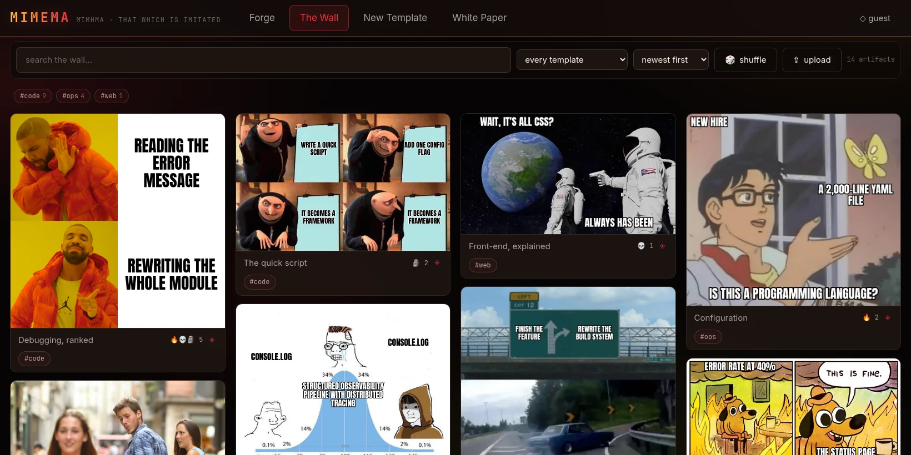
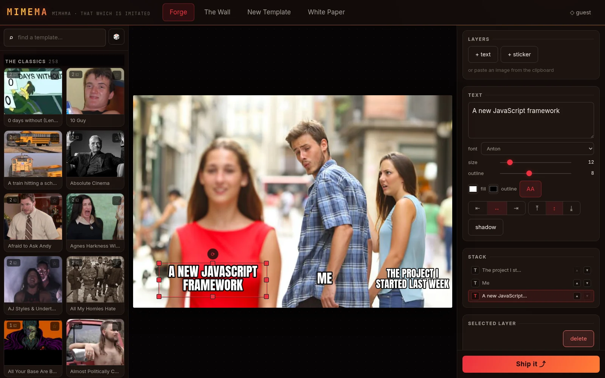
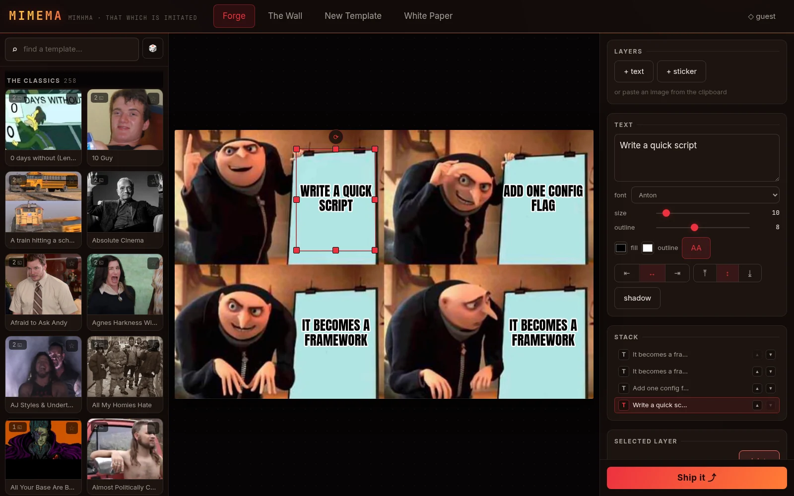
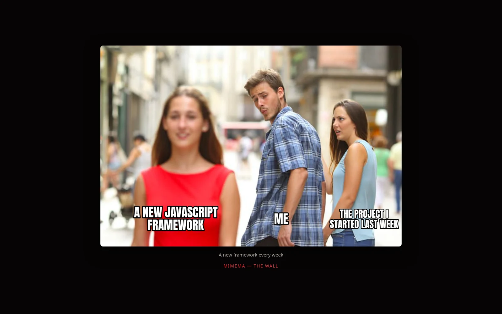
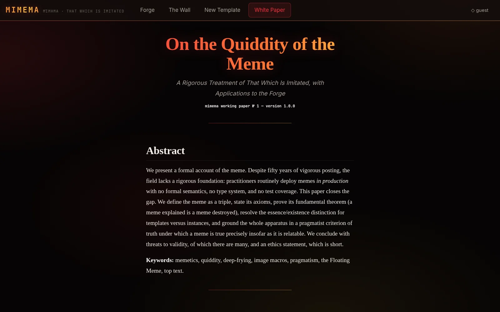

<p align="center"></p>

# mimema

[](https://github.com/ZahakJ/mimema/actions/workflows/ci.yml)
[](LICENSE)

A self-hosted meme editor and media host: make a meme from a template,
download the PNG, or publish it to a permanent, hotlinkable URL that unfurls
in chat apps. Live at <https://meme.avicenna.space>.

## Install

Node 26 or later.

```sh
git clone https://github.com/ZahakJ/mimema && cd mimema && npm install
npm run templates && npm run templates:layouts   # fetch ~260 templates into data/
cp .env.example .env                             # set INVITE_KEY and PUBLIC_ORIGIN
npm run build && npm start                       # http://127.0.0.1:8001
```

## Use

| | |
| --- | --- |
| `#/` | The forge: pick a template, edit the captions, add stickers or paste an image, deep-fry, then download or publish. |
| `#/wall` | Everything published: search, filter by tag or template, sort by reactions, react, upload. |
| `#/add-template` | Draw caption zones on any image to make a template. |
| `#/paper` | [The white paper](WHITEPAPER.md). |

Viewing and making memes need no key. Publishing, uploading, adding templates
and deleting need `INVITE_KEY`, entered once in the app or sent as the
`x-meme-key` header.

Published files are served at `/m/<slug>.<ext>`, which never changes, and
`/m/<slug>` is a share page with OpenGraph tags. PNG, JPEG, GIF, WebP, MP4 and
WebM are accepted, up to 12 MB for images and 40 MB for video.

<p align="center">
  
  
</p>
<p align="center">
  
  
</p>

## How it works

- A Hono server, run by Node directly from TypeScript, keeps metadata in SQLite and files on disk under `data/`.
- One canvas function draws both the preview and the export; the export re-renders at the template's native resolution.
- Caption zones are rectangles in fractions of the image, placed by hand per template in `scripts/layouts/`.
- Uploads are typed by their bytes, deduplicated by SHA-256, and given an adjective-noun slug.
- Writes require one shared key in a custom header; with no CORS, cross-origin writes fail their preflight.
- An optional daemon, `relay/`, turns a chat transcript or the day's news into a published meme.

## Documentation

- [Architecture](docs/ARCHITECTURE.md): layout, data model, rendering, security, tests
- [HTTP API](docs/API.md): items, templates, media URLs, headless export
- [Templates](docs/TEMPLATES.md): import, curated layouts, duplicates, meanings
- [Relay](docs/RELAY.md): the text-to-meme daemon
- [Deployment](docs/DEPLOYMENT.md): configuration, proxies, systemd, backups
- [Contributing](CONTRIBUTING.md) and [security](SECURITY.md)

## License

[MIT](LICENSE). Template images downloaded by `npm run templates` are not
covered and belong to their owners. Fonts ship under their own open licenses.
